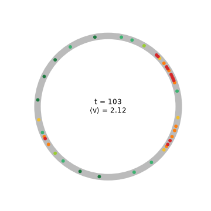
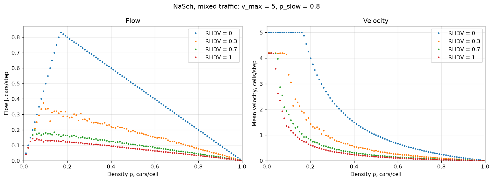
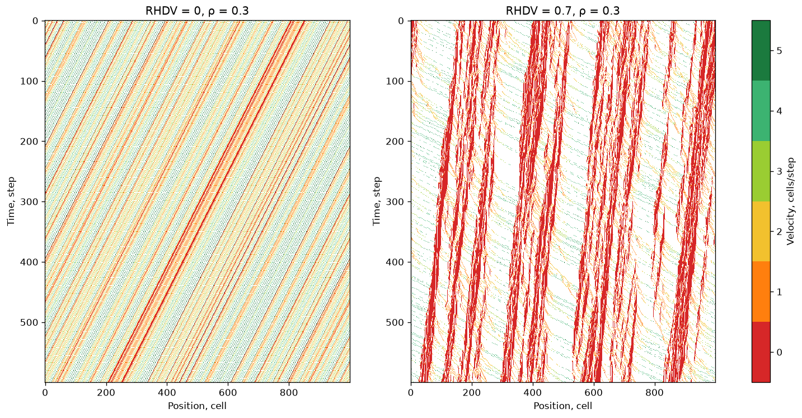
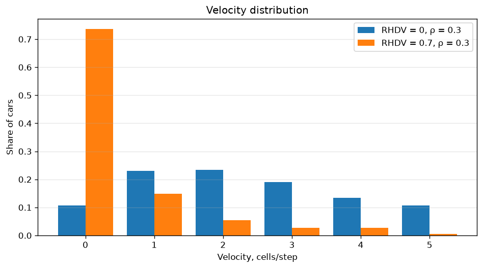
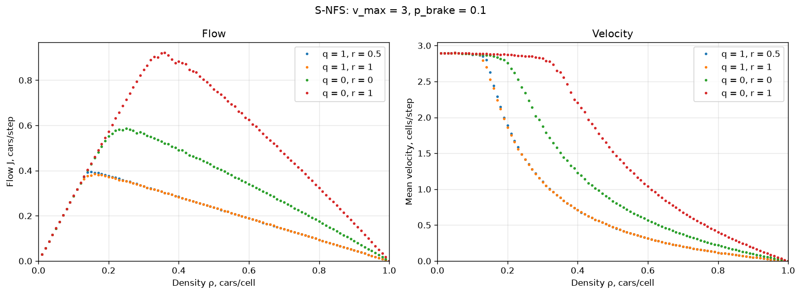

# Traffic-Flow Cellular Automata

[](https://github.com/yndarra/traffic-flow-cellular-automata/actions/workflows/tests.yml)


**English** | [Русский](README.ru.md)

Microscopic traffic simulation on a circular road with two stochastic
cellular-automaton models:

* **Nagel–Schreckenberg (NaSch)** with *mixed traffic*: some cars are driven by
  humans who brake at random, and the rest are automated and drive
  deterministically;
* **S-NFS**, a stochastic extension of the Nishinari–Fukui–Schadschneider model
  (Sakai, Nishinari, Iida, 2006), which adds a *slow-to-start* delay and
  *anticipation* of the car two positions ahead.

The project builds fundamental diagrams (flow against density), space-time
diagrams and velocity distributions, and measures how the share of human
drivers limits road capacity.

<p align="center">
  
</p>
<p align="center"><sub>200-cell ring road, density 0.2. Color shows speed (red means stopped).
Jams appear "out of nowhere" and travel against the traffic.</sub></p>

> Coursework for the *Computer Modelling* university course.

## Models

The road is a ring of `L` cells, and each cell holds at most one car. Velocity is
an integer from `0` to `v_max` cells per step. All cars are updated in parallel.
Cars never overtake, so each car's leader stays the same and the update is
vectorized over all cars at once.

### NaSch with mixed traffic

1. **Acceleration:** `v ← min(v + 1, v_max)`
2. **Braking:** `v ← min(v, gap)`, where `gap` is the number of empty cells to the leader
3. **Random braking:** `v ← max(v − 1, 0)` with probability `p_slow`, **for human-driven cars only**
4. **Movement:** `x ← x + v`

`RHDV` (ratio of human-driven vehicles) is the share of cars that brake at random.
`RHDV = 1` is the classic NaSch model. `RHDV = 0` is fully deterministic
traffic of automated cars.

### S-NFS

1. **Acceleration:** `v ← min(v + 1, v_max)`
2. **Slow-to-start**, with probability `q`: the driver reacts to the gap from the
   *previous* step, `v ← min(v, x'ᵢ₊₁ − x'ᵢ − 1)`
3. **Anticipation (quick start)**: with probability `r` the driver looks `S = 2`
   cars ahead, otherwise `S = 1`: `v ← min(v, xᵢ₊ₛ − xᵢ − S)`
4. **Random braking** with probability `p_brake`, which is `1 − p` in the
   original paper
5. **Collision avoidance:** `v ← min(v, gap + v_leader)`
6. **Movement:** `x ← x + v`

## Results

### NaSch: human drivers limit capacity

The model uses `v_max = 5` and `p_slow = 0.8` on a ring of 1000 cells. Each point
is averaged over 500 steps after a 2000-step warm-up, then over 3 independent
initial placements.



| RHDV | Maximum flow, cars/step | at density |
|---|---|---|
| 0 (all automated) | **0.830** | 0.17 |
| 0.3 | 0.374 | 0.09 |
| 0.7 | 0.199 | 0.05 |
| 1 (all human) | 0.144 | 0.04 |

Fully automated traffic matches the theoretical optimum
`J_max = v_max / (v_max + 1) = 5/6` at `ρ = 1/(v_max + 1)`. Even 30% of human
drivers cut the road's capacity by more than half, because every human car
becomes the slow leader of a platoon.

### Space-time diagrams

Time runs downward and cars move to the right. Red stripes are jams that drift
*backward* against the traffic.



At density 0.3 the automated traffic moves at an average speed of 2.33 cells per
step, with 10.7% of cars standing still. With 70% human drivers the average speed
falls to 0.48, and 73.6% of cars stand in jams.



### S-NFS: slow-to-start versus anticipation

The model uses `v_max = 3` and `p_brake = 0.1`.



| q | r | Maximum flow | at density |
|---|---|---|---|
| 1 | 0.5 | 0.394 | 0.15 |
| 1 | 1 | 0.385 | 0.16 |
| 0 | 0 | 0.586 | 0.25 |
| 0 | 1 | **0.921** | 0.36 |

With permanent slow-to-start (`q = 1`), anticipation hardly matters: a car stopped
in a jam waits one extra step regardless of what the cars ahead do. Without
slow-to-start, anticipation lets cars follow each other at very short distances.
Capacity rises by almost 60% (0.921 against 0.586), and the peak moves to a much
higher density.

## Getting started

```bash
git clone https://github.com/yndarra/traffic-flow-cellular-automata.git
cd traffic-flow-cellular-automata
python -m venv .venv
.venv/Scripts/activate        # Windows; on Linux/macOS: source .venv/bin/activate
pip install -r requirements.txt

python main.py                # every experiment (about 2 minutes), images go to images/
python main.py nasch          # one experiment: nasch | xt | snfs | ring
```

To run the tests:

```bash
pip install -r requirements-dev.txt
pytest
```

The tests check that cars never collide or overtake, that the number of cars is
conserved, and that deterministic NaSch reproduces the analytical flow
`min(ρ·v_max, 1 − ρ)`.

## Project structure

```
traffic_flow/
├── models.py         # RingRoad base class, NaSch (mixed traffic), SNFS
├── experiments.py    # fundamental diagram, x-t diagram, velocity histogram
└── visualization.py  # plots and the ring-road animation
tests/                # invariants and analytical checks
main.py               # command-line entry point
```

## References

* K. Nagel, M. Schreckenberg. *A cellular automaton model for freeway traffic.* J. Phys. I France 2, 2221 (1992).
* S. Sakai, K. Nishinari, S. Iida. *A new stochastic cellular automaton model on traffic flow and its jamming phase transition.* J. Phys. A 39, 15327 (2006).
* [Nagel–Schreckenberg model](https://en.wikipedia.org/wiki/Nagel%E2%80%93Schreckenberg_model) on Wikipedia.

## License

[MIT](LICENSE)
